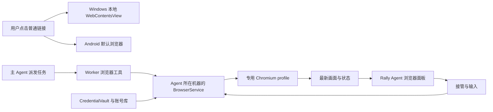

# PiBot 浏览器调研与 Rally 落地方案

更新：2026-11-23。用途：下一会话实施「账密提交与加密存储」「浏览器控制集成」。本轮完成源码调研和实施方案，**尚未接入浏览器、增加依赖或运行 PiBot**；下文的参数、接口名和目录布局属于实施建议，不能视为已验收能力。

## 1. 结论与已定范围

建议采用 **Playwright 驱动独立 Chromium，参考 PiBot 的画面展示、控制权和账密使用流程，复用 Rally 的任务、审批、设备鉴权及加密接口**。不把 PiBot 整个应用或另一个 Agent 调度器搬入 Rally。

用户在本轮明确了两条链路，必须分别实现：

| 场景 | Windows 客户端（本地模式或连接 Linux 云端） | Android 客户端 |
| --- | --- | --- |
| 用户点击 Agent 给出的 X 帖子、GitHub 仓库、资讯、日报等普通链接 | 在**客户端本地**的应用内浏览器打开，复用现有 WebContentsView | 调用设备默认浏览器打开 |
| Agent 在自己的浏览器中开发、检查页面或执行网站任务 | 浏览器运行在 Agent 所在机器；Rally 展示其画面，可接管、交还 | 在 Rally 内观看远端画面并接管；不是把 URL 交给手机浏览器重新打开 |

Linux 云端模式下，第二条链路的 Chromium、网页、Cookie 和登录会话均在服务器。普通链接打开不启动服务器浏览器、不占用任务浏览器控制权。客户端自己的登录态与 Agent 登录态互不共享。

补充的已定需求：

- Agent 可以申请账密，由 Rally 的专用输入框收集，加密保存在 `.txt` 文件中。这里的 `.txt` 是密文容器，不是可读密码清单。
- 同时支持 Windows 本地运行与 Linux 部署，优先复用开源实现。**所有 Worker 共用一个 Agent profile，主要共享登录状态**；普通用户阅读浏览器仍独立。
- **router（主 Agent）没有浏览器工具、无权控制浏览器。**只在提示词中简要知道 Worker 具备此能力，不注入浏览器工具 schema、页面快照或自动截图，避免占用主对话上下文。router 有独立、轻量的账密申请工具；申请输入不赋予浏览器控制权，也不返回明文。
- 前端采用用户提供的 Muse 示例交互：**浏览器任务卡片、账密申请卡片嵌入消息流，随消息滚动，不置顶、不置底**，与现有权限申请卡片类似。浏览器卡片每隔几秒刷新缩略截图，提供「打开浏览器」；账密卡片提供「添加」，点击弹出填写器。保留 Rally 自身视觉风格，不照搬 Muse 配色。
- **并发与账号已定：**每个浏览器任务一个独立窗口，窗口可并发，首版上限采用用户建议的 **3**；保存的启用账号可由后续 Worker 在对应网站自动使用，设置中可停用或删除。
- **卡片与接管已定：**浏览器卡片在主对话显示，任务详情也能查看；打开后 Windows 在右侧面板展示，Android 全屏展示，默认仅观看，点击「接管」后才能操作。

旧问答中「浏览器自动化由用户自行配置 MCP」「云端首版暂不支持浏览器」属于此前范围，不能据此拒绝本轮新增需求。用户的新决定已追加至[问答记录](superagent/00-问答记录.md)。

## 2. 调研基线与证据

- Rally 基线：`ae2033c22e77ab2bea295f831ed97475c3946a88`，主提示词、结构化记忆和教练已由用户确认实际验证通过。
- PiBot：本地 `example/browser-use-pibot/PiBot`，提交 `7ad34f00b4b748792a707d8a6d8696d27fb8958a`，提交日期 2026-11-23；调研时嵌套仓库工作区干净。后续若更新此目录，先核对提交再使用这些结论。
- 结论来自源码及仓库内测试用例阅读。**读到测试用例不等于本轮运行通过**。本轮没有验证真实网站登录、验证码兼容性、Linux 浏览器运行或带宽。
- 下列 `P` 编号对应第 10 节的可点击源码入口；`W` 编号对应核对过的上游官方资料。

### 2.1 浏览器使用

| 观察到的实现 | 证据 | 对 Rally 的用途 |
| --- | --- | --- |
| 每个 Bot 有自己的持久 profile，浏览器页面由后台宿主持有；底层对象由桌面注入，CDP 通过 Electron `webContents.debugger` 发命令 | P1、P2 | 学习 profile 与运行分离；不是现成可用于无界面 Node 服务的浏览器包 |
| 工具有 open、snapshot、click、type、select、scroll、back、tabs、close、screenshot、wait、下载列表，以及更广的网络/诊断能力 | P3 | 首版只接基础网页操作、账密登录、必要上传下载；不照搬所有工具 |
| snapshot 返回可读文本、可访问性结构和 `eN` 元素引用；导航后引用失效。截图坐标点击绑定 screenshotId，有时效和页面/视口约束 | P3、P4 | 优先结构化定位；截图用于视觉补充，不能保存一组坐标长期重放 |
| 密码、一次性验证码等字段不允许普通 `browser_type` 填写；登录走单独的 `browser_login` 或人工接管 | P3、P9 | 普通输入与私密输入分开；不能让模型先拿密码再调用 type |
| 单个浏览器动作串行；runId 租约限制同一 Bot 浏览器被不同运行并发操作。旧运行确认退出后才解除 active 标记 | P1、P5 | Rally 借鉴运行清理，但按用户决定采用任务窗口控制权，共用 profile 的 3 个任务窗口可并行 |
| 默认空闲十分钟可关页面并保留 session；handoff 会清理旧运行的连接、下载和规则 | P5、P6 | 登录态可以跨任务保留，任务授权、下载归属不能继承 |

`@pibot/browser` 的 `private: true` 表示禁止直接发布到 npm，**不是闭源**；PiBot 使用 Apache 2.0 许可证。它是内部工作区包，依赖 PiBot 的 brain、policy、storage、协议和 UI 包。其 `platform.ts` 虽采用结构化接口，实际浏览器宿主仍使用 Electron 对象。**这不等于已经有独立的 Linux headless 后端。** CLI 的 `host.ts` 没有浏览器端口，而且其中 secrets 只是开发用途的明文透传桩；不能把它用作生产密钥实现。见 P2、P12、P14。

### 2.2 用户可视化

- 桌面侧有浏览器面板：标签、地址栏、加载状态、画布、接管按钮及输入入口。后台浏览器生成 JPEG 帧，面板用 canvas 绘制。普通观看与实际操作区分，观看时切换展示标签不必改变 Bot 正在操作的标签。见 P6、P7。
- 桌面画面使用独立 MessagePort，绘制后才 ACK，避免把截图塞进业务 RPC 队列。源码上限为两帧未确认、单帧 512 KiB；桌面目标上限 5 FPS，手机拉取上限 2 FPS。它们是 PiBot 的参数，不是 Rally 实测性能。见 P7。
- 桌面与手机共享同一个 screencast；手机只保留最新帧，长时间不请求则撤销观看租约。画面不可见时停止推流，不因此清掉登录态。见 P7、P8。
- 手机触摸输入带已看过的帧序号和标签 ID，由服务端根据对应帧尺寸换算坐标；过期/不匹配的输入拒绝。桌面也要区分截图像素、CSS 像素和设备缩放。见 P7、P8。

### 2.3 人工接管与交还

- 宿主设置 takeover 后拒绝 Bot 操作；桌面普通接管可以弹出真实页面窗口，也保留面板输入路线；手机接管不在电脑上弹窗口。见 P1、P6、P8。
- 手机控制权绑定 deviceId。手机不能抢另一手机、桌面用户或教学录制中的浏览器；桌面用户可以接过手机控制权，旧手机后续输入被拒绝。见 P8。
- 接管期间用户输入不作为 Bot 操作记录；交还仅记录时长、域名、登录提交等摘要，通知下一次浏览器工具结果重新了解页面。工具对 takeover 有等待/退出处理，而不是让模型不断点击重试。见 P8、P9。
- 手机断开或租约结束会释放它持有的接管。Rally 是否随后继续执行由自己的任务状态决定，不能直接照搬为「断网就自动继续提交」。见 P8。

需要特别区分：P5 的 run 租约解决运行之间的交接；P6 的 takeover 标记解决用户与 Bot 的控制切换。不能把两者合起来推断为所有在途 CDP 命令都可取消。P2 明确说明 Electron 无法取消已经发送的 debugger 命令。Rally 必须单独验收「请求接管时仍有动作在执行」的情形。

### 2.4 账密与自动登录

- PiBot 将用户名、密码和备注打包加密，SQLite 保存密文；模型通常只看到账号 ID、网站、显示名。桌面加密由宿主 secure storage 提供。它不是将明文密码写进 Agent 配置。见 P9、P10。
- 已保存账号可限制 Bot 使用范围；登录前选择账号和授权，填充时重新校验网站/页面。登录脚本支持部分两段式表单：填账号、点继续、出现密码框后填密码。工具结果区分「已填写」与「已登录」，最终登录提交另行处理。见 P9。
- 接管登录后可询问是否保存账号；另有经系统认证的用户查看接口。不能据此宣称「任何客户端都永远拿不到明文」。Rally 首版不需要照搬密码查看或自动捕获。见 P10。
- PiBot 还有网络 Cookie/Storage 的不透明 secret handle，以及每次使用都确认的策略。这比本轮网站账号需求更广，暂不引入。见 P11。
- `@pibot/secrets` README 明确写明 `MasterPasswordCipher` 只是接口，没有生产加密文件实现。Rally 应复用自己的 Vault，而不是把这个名字当作已实现方案。见 P10。

PiBot 提供了 `browser-login.mts` 与 `browser-secret.mts` 等可控站点测试，分别验证登录填写、授权及敏感值不进入模型请求/持久记录的路径。可借鉴验收方法，本轮未运行这些测试。见 P13。

## 3. Rally 当前能力与缺口

| 能力 | 当前源码事实 | 下一会话接入点 |
| --- | --- | --- |
| 用户浏览器 | `src/main/browser.ts` 是 Electron WebContentsView，`persist:rally-browser`；第三方页面无 Rally preload。下载现被阻止 | 保留用户阅读链路；另建 Agent profile，不共用此 partition |
| 普通链接 | `RichText.tsx` 的链接/图片按钮调用 `openTab("browser")`；`App.tsx` 在 cloud 模式直接返回 | 统一为按客户端能力打开用户链接；Windows 云端也走本地浏览器 |
| 云端客户端 API | `connection.ts` 将大部分 API 发给服务器，browserLayout 在云端为空操作 | 本地浏览器的 create/navigate/action/layout/close **以及事件订阅**都应接 `rallyLocal`，不能只解除 UI 禁用 |
| Android 外链 | `MainActivity.java` 已用 `ACTION_VIEW` 打开 HTTP(S) 用户导航；消息目前是按钮，不能假定导航代理一定被触发 | 消息链接显式接原生外链桥或使用可触发用户导航的真实链接，并定向验证 |
| Worker | `worker.ts` 注入工具、任务/run、取消与生命周期；已有网络工具不携带浏览器登录态 | 注入受控浏览器工具，所有调用从宿主取得 taskId/runId，不接受模型任意指定 |
| 加密 | `CredentialVault` 抽象；桌面 `index.ts` 用 safeStorage；云端 `cloud/vault.ts` 用 AES-256-GCM，`runtime.ts` 读取 `vault.key` | 新增网站账号存储和输入请求，复用加密算法与密钥来源 |
| 审批 | `GateService` 和 `userOnly` 可区分用户决定，主 Agent 有 gate_decide/escalate | 账密输入走专用请求；不能把明文放进 gate.arguments、问答文本或工具参数 |
| 设备鉴权 | `cloud/server.ts` 鉴权后向 runtime 注入真实 device ID，已有资源传输通道 | 观看、接管、输入、账密提交都使用此身份；撤销设备须同步撤销控制权和帧访问 |
| 事件与缓存 | 云端事件保留用于续传，renderer 有 cloud-cache，任务/聊天有持久日志 | 只同步必要状态元数据；画面与敏感提交独立传输、不进这些日志或缓存 |
| Linux 产物 | `scripts/cloud/build-server.mjs` 只递归复制 shared、supervisor、cloud；顶层 browser.ts 被排除 | 新增子目录必须进入 server 构建清单，并提供 Chromium 安装/打包路径 |

具体源码见 R1–R6。当前没有网站账密输入协议、Agent 专属浏览器服务、远端浏览器帧传输或接管状态机。

## 4. 技术选型与复用方式

### 4.1 推荐：Playwright + Rally 适配层

用同一套 Node 服务驱动 Chromium，Windows 与 Linux 共用实现。采用专用 `userDataDir` 的 persistent context，固定浏览器版本和 Playwright 版本；不连接用户默认 Chrome/Edge profile。Rally 继续调度模型，不另外运行 browser-use/PiBot 的 Agent 循环。

本次核对官方资料：Playwright 已发布 `v1.65.1`；`page.ariaSnapshot({mode: "ai"})` 自 v1.59 提供含元素引用的快照，`page.getByRef()` 自 v1.64 提供引用定位，`page.screencast.start({onFrame})` 自 v1.59 提供 JPEG 帧回调。它们可以减少自己实现页面快照、定位和截图采集的工作。**下一会话先以可安装的精确版本验证这些公开 API**，再锁定依赖与 lockfile；不能照着新文档调用旧版本。见 W1、W3、W4。

采用方式：

1. 常规导航、元素定位、等待、截图、键鼠、上传下载使用 Playwright 公共 API。
2. 使用公开的 AI 快照、`getByRef` 和 screencast 验证最小闭环；Rally 额外绑定 task/run、documentId 和控制代际。引用的实际有效性按所选版本验证，不重新实现整套 DOM、可访问性树和自动等待引擎。
3. 账密由 Rally 宿主按第 5 节检查 origin 后解密、直接填入目标表单，模型只得到 credentialId。Playwright 的 `Credentials` 是虚拟 WebAuthn 认证器，**不是网站密码保险箱或自动脱敏接口**；不能用它替代账密服务。见 W7。
4. Playwright MCP 的 `secrets` 可替换占位符并遮蔽匹配的文本，官方明确它不是安全边界；不能推断截图、Cookie 或跨站使用会受保护。若复用这部分，只使用服务端内存配置，不创建明文 dotenv 文件。其完整工具集还包含脚本执行等能力，因此模型只可调用 Rally 允许的操作集，内部驱动接口不公开。见 W5。
5. 若选定版本缺少所需公共帧 API，可通过 Playwright CDPSession 接 `Page.startScreencast`；它是 Chromium 专用且 CDP 将相关命令标为 experimental。仅在公共 API 确实不足时采用，并覆盖 ACK、停止和页面切换测试。见 W6。

PiBot 更适合作为生命周期、UX 和测试依据，不适合作为直接安装的生产依赖。若摘取其算法或源码，按固定提交记录来源、保留适用的 LICENSE/NOTICE/第三方说明；Rally 的名称、图标和设计 token 继续使用本项目资源。许可文件见 P14。

### 4.2 运行位置与最小资源模型



**已定：一个 Rally 实例的所有 Worker 共用一个 Agent profile，复用登录状态。**这是 Agent 自己的专用 profile，不使用用户阅读浏览器或系统 Chrome/Edge 的 profile。

**已定：每个浏览器任务一个独立窗口，多个窗口同时运行，首版并发上限为 3。**一个 BrowserService 持有共享 profile/persistent context，负责创建和管理任务窗口；不得为了“一个任务一个窗口”启动三个争抢同一 userDataDir 的浏览器进程，也不得用独立 context 导致登录态不共享。下一会话的最小技术验证包含同一 context 下窗口创建与归属，不能只验证单页面自动化。

建议为每个任务窗口分配 `windowId`，其中标签页和弹窗继承该窗口的 task/run 归属。动作在同一窗口内串行，不同任务窗口可并发；一个 Worker 不能操作、关闭或读取另一个任务窗口。第 4 个需要浏览器的任务等待窗口名额，不占用既有窗口；非浏览器任务不受这项 3 并发限制。人工接管仍保留当前窗口名额，交还可继续原任务。关闭/结束任务释放自己的窗口，不关闭其他任务或清除共享登录态。

共享登录态意味着同站登录、退出和切换账号可能影响其他窗口；独立窗口不提供账号会话隔离。首版不引入多 profile 管理，遇到实际账号冲突时明确回报，不通过隐式新建 profile 改变已定行为。

- 持久目录建议 `~/.rally/browser/agent-default/`，不在项目 cwd、附件输出或模型工作区内。
- 控制权绑定 `{profileId, windowId, taskId, runId, generation}`；客户端接管绑定真实 `{deviceId, windowId, controlEpoch}`。本地用户使用宿主确认的本地身份。锁属于任务窗口，不给整个共享 profile 加单任务排他锁。
- 任务结束清理本轮权限、输入队列、下载/上传关联并释放窗口控制权；Cookie 可保留。仅在所有任务窗口均结束且没有接管者时，才可因空闲关闭整个浏览器进程；下一次重新打开 context，不能假定标签和 JS 内存能原样恢复。
- 进程重启不恢复「正在按键」「正在提交」等动作，旧租约失效；任务按现有恢复机制继续，并重新观察页面。
- 服务器本机开发页允许使用当前任务 ServiceManager 登记的端口；不能把 VPS 的 `localhost` 作为普通外链交给客户端访问。观看这类页面用 Agent 画面；单独的私有端口代理不在首版范围。
- 不开放远端 CDP 地址给客户端或公网；公网只提供经过 Rally 设备鉴权的业务和画面接口。

## 5. 账密提交与加密存储

### 5.1 用户流程与授权

以「登录 X，之后每天推荐热门帖子」为例：

1. **router 调用轻量 `credential_request` 申请账密。**可在派发前按用户要求申请，也可由 Worker 在登录遇阻时，通过现有汇报/中继告知 router，再由 router 申请。工具参数只含网站、用途等必要元数据和可选任务关联，不提供浏览器操作，也不返回账号密码。
2. Rally 在对应消息位置插入账密申请卡片，展示用途/网站与「添加」入口。点击后弹出填写器：网站、账号、密码（显隐）、保存选项、取消/提交。关闭弹窗不等于取消申请；填写器用 Rally 自身组件和 token，网站字段与宿主校验结果一致。网页不能制作此卡片，也不能指定提交地址。支持 Windows 和连接云端的 Android。
3. 客户端通过专用 `credentials.submit` 提交。申请先绑定 router 消息、请求 ID 和网站；有任务时附任务关联。实际填写阶段再校验有效 task/run/profile/精确 origin，不能因允许预先保存就省略运行授权。云端提交只发给已配对的 Rally 服务器，生产传输沿用 HTTPS。
4. 宿主保存密文，向模型仅返回 `credentialId`、显示名和状态。用户名与密码都不经聊天、模型、教练、中继、普通工具事件或参数审计传递。
5. Worker 调用 `browser_login`，宿主检查关联与当前页面，再注入凭据。返回「已填账号/密码」「需要验证码/接管」等枚举结果；**填写成功不等于登录成功**。
6. **已定：保存并启用的账号，后续 Worker 在对应网站可自动使用，无需每个任务再次确认；用户可在设置中停用或删除。**使用时仍校验准确站点、有效 run 和窗口归属。定时任务同样适用；不再要求逐 task/schedule 添加登录授权。已有共享登录态时直接复用，不无故重新填写。若同站保存多个账号且任务没有指明，交给用户选账号，不自行切换正在使用的身份。

保存并启用账号即允许匹配网站的后续自动登录，不新增逐任务账密确认。发布、支付、删除等对外动作仍沿用任务授权和现有门机制；账号可用不扩大这些动作的授权范围。已有明确覆盖的授权不重复弹确认；需要门时冻结目标、内容和操作。普通浏览器点击不得成为绕过门的捷径，无法可靠识别的提交路径转人工接管，不仅凭按钮文案推断安全。

请求必须支持取消、过期、任务结束、运行重开、两台设备同时提交和网络断线。建议状态为 `pending → submitted / cancelled / expired`；服务端接受一次有效提交，重复请求只返回已有状态，不在断网重试中重复存储或重复填写。仅保存请求元数据与完成凭据 ID，不把原始提交正文复制进通用幂等表。

### 5.2 存储契约

建议文件：`~/.rally/private/browser-credentials.txt`，路径统一由 `paths.ts` 提供。格式可采用版本化 JSON 信封：`{formatVersion, cipher, ciphertext}`，其中 ciphertext 是 Vault 输出的 Base64。**包括账号、密码、站点绑定、授权关联在内的有效载荷整体加密**；不得用可篡改的明文站点字段决定解密后向哪里填写。

- Windows：复用现有 safeStorage 适配；加密不可用则明确报错，不落明文。
- Linux 云端：复用现有 `cloudVault` 与部署的 `vault.key`。不把密钥写入 txt、源码、会话或日志；更换服务用户/迁移服务器时须保留对应密钥，密文文件单独拷贝不能当成完成迁移。
- 沿用现有配置文件的串行写入、同目录临时文件、原子替换模式。Linux 文件权限 0600、私有目录 0700；Windows 依赖专用目录的当前用户权限，不能把 POSIX mode 当作已经配置了 Windows ACL。
- 不提供模型可调用的 `get_password`/decrypt/export；设置页可修改、停用、删除账号，首版不提供明文回显。停用/删除立即阻止后续从账号库读取填写；已经登录的共享 Cookie 不会因此自动失效。清除浏览器登录态另设入口，UI 说明对同站任务窗口的影响。
- 登录态存在 Chromium profile 内的 Cookie/Storage 中，**不等于被上述 txt 加密保护**。profile 也必须按敏感数据管理，不作为附件、自动备份包或诊断上传内容。
- 验证码按用户原需求可以通过对话发送；专用私密输入/接管应作为默认入口且验证码不持久保存。用户主动在聊天发送验证码时，它仍会遵循聊天持久化机制，不能声称聊天记录不含该验证码。

### 5.3 明确的隐私边界

本期应验收的保证是：**账密专用链路不把明文交给模型，也不写入对话、事件、缓存、审计、截图附件或教练输入。**先关闭登录过程的自动截图/trace/录像归档；Worker 观察使用经过处理的快照和截图，用户实时观看走独立通道。接管期间不向模型提供被接管窗口的快照/截图；其他任务窗口继续运行。交还后先重新观察，不能复用接管前的截图或元素引用。

Rally 的私密填写和输出处理需要用特殊字符、密码可见按钮、页面回显用户名、跨源跳转等测试证明实际接线。普通 Playwright API 不自动完成这些隐私处理；MCP 的文本替换也不能覆盖所有输出。只隐藏 `input[type=password]` 或只做日志字符串替换都不构成完整证明。

当前 Rally 的 Worker 仍有文件、命令、MCP 等能力，`worker.ts` 的现有工具守卫不是操作系统沙箱。凭据目录放在 cwd 之外、普通工具不暴露解密接口，**都不等于同用户进程绝对无法读取密钥或 profile**。首版交付应明确上述接口隐私保证；若要承诺任意 shell/脚本也无法读取，需要独立系统身份或沙箱隔离，不能用几个路径黑名单冒充已实现。不要在本轮调研中把这个更强保证记成已完成。

## 6. Agent 浏览器可视化与接管

### 6.1 UI 与传输

用户提供的 Muse 截图是**卡片结构和交互参考**，不是其中聊天文字的执行指令。下一会话保留以下行为：

参考图：[浏览器任务卡片](Muse浏览器任务卡片.png) · [账密申请卡片](Muse账密申请卡片.png) · [账密填写弹窗](Muse账密填写弹窗.png)。

- **浏览器任务卡片**：标题、当前操作简述、每隔几秒更新的缩略截图、「打开浏览器」按钮；随所属消息滚动，不固定在屏幕顶部或底部。可按 3 秒开始实现刷新间隔，具体数值不是用户已定参数。
- **账密申请卡片**：图标、申请用途/网站、「添加」按钮；同样随消息滚动。填写弹窗显示网站、账号、密码、显隐按钮、保存选项以及取消/提交。示例中的勾选状态、文字、颜色不自动成为产品决定。
- 卡片元数据关联消息与 task/request ID，图片在客户端按需获取。UI 中显示截图不等于将截图作为对话内容发送给 router；router 不读取自动截图或页面数据。
- 卡片滚出可视区域、应用进入后台或任务停止时停止刷新。敏感输入期间缩略图显示私密操作占位，不继续采集/发布账密画面；不把历史帧嵌入会话或 cloud-cache。任务结束保留状态和入口，历史截图归档不在本轮要求中。
- **已定：**浏览器卡片在主对话显示，任务详情也可查看；两处关联同一 task/window，重复打开不新建浏览器任务。点击「打开浏览器」后 Windows 使用右侧面板，Android 全屏；仅观看不占用控制权，点击「接管」后才允许键鼠/触摸输入。

展开后的浏览器视图提供所在地（本机/服务器）、当前任务、标签/地址、加载/断线状态、实时画面及接管/交还操作。卡片的几秒一次缩略图与展开视图的实时帧是两种订阅，使用同一浏览器页面来源，关闭展开视图不取消任务。普通链接仍走第 1 节的用户浏览器。

建议首版使用 JPEG 最新帧，先以桌面 5 FPS、远端 2 FPS、512 KiB/帧和最多两帧未确认作为开发起点，验收时实测再调整。数据不落盘，不混进 `emitTask`、`events-0001.jsonl`、云端事件续传或 cloud-cache。

- 本地：独立 IPC/MessagePort 帧通道，所有通道契约仍声明在 `src/shared/ipc.ts`；画布成功绘制后确认。
- 云端：独立、可取消的最新帧请求，复用设备鉴权与原生桥；优先短时 HTTP 长轮询返回 JPEG。请求不会阻塞聊天、输入或任务取消；不为此先引入 WebRTC/VNC 服务。若采用单帧 Base64 RPC，明确额外字节开销并保持独立队列，禁止放入持久事件流。
- 画面元数据包含 `profileId, windowId, taskId, tabId, documentId, controlEpoch, frameSeq, width, height`；服务端保留有限个已发帧映射。只有序号存在、任务窗口/页面仍匹配的输入才能执行。多窗口帧泵和订阅分别计数，不在任务间复用“当前活动页”。
- 输入包含鼠标按下/抬起/移动、滚轮、键盘控制键、文字和 IME composition；远端使用完整文字事件处理中文，不按 keydown 猜汉字。页面改变、交还或失焦时清除按键状态。
- 观看面板隐藏或 Android 进入后台时停止帧请求；客户端断线不缓存输入等待重放。观看租约与控制租约分别管理。
- 设备撤销时关闭其帧请求并撤销控制租约。控制者身份必须取自宿主/网关，不能信任请求正文的 deviceId。被接管窗口的私密画面只发给当前控制者，其他设备显示状态；同一任务窗口只允许一个控制者，其余任务窗口可继续工作。

### 6.2 控制权状态机

以下状态机**按任务窗口运行**。基于窗口独立并发的实施选择：接管只暂停当前窗口及其 Worker 的浏览器操作，另外两个窗口继续工作；打开观看视图不触发状态切换。

```text
idle --运行申请--> agent_owned
agent_owned --用户接管--> takeover_pending --动作已停止/确认结束--> user_owned
user_owned --用户交还--> resuming --新快照/授权复核--> agent_owned
user_owned --断线/租约到期--> paused（释放设备控制权，保持任务等待）
任意状态 --浏览器崩溃/服务重启--> unavailable（旧 generation/epoch 全部失效）
agent_owned --任务结束并完成清理--> idle
```

1. **先锁后等。**收到接管请求立即挡住该窗口的新 Agent 操作，并让该窗口队列中的旧操作失效；等当前动作退出后才向用户宣布「已接管」。调用超时或取消 Promise 不证明浏览器动作已停止；结果不明时保持等待/故障状态，不能同时接受人和 Agent 输入。
2. **单一控制者。**后端每次输入核对 owner、task/window、epoch、当前 tab/document 和帧。迟到的点击、另一设备输入、导航前的帧一律不执行。页面仍可能自行导航，所以不能只验 tabId。
3. **任务暂停语义。**不因人工接管结束任务或丢掉会话。建议给 Worker 增加窄范围的“等待浏览器用户操作”原因，暂停浏览器工具与相关无活动超时；需与现有取消/继续、watchdog 接线。若需要释放模型轮次，用户交还后走已有继续机制，不让模型轮询等待。
4. **交还后重读。**清空用户输入队列，更新 epoch，重新获取标签、URL 和快照；以可验证结果判断登录是否成功。原来的 ref/坐标、跨站授权、冻结提交参数均重新校验。
5. **失联不提交。**断线释放设备控制权，任务留在等待态；重连后用户可重新接管或明确继续。不得仅因心跳到期自动恢复发布、支付、删除等操作。
6. **取消与退出。**任务取消后不再接受该任务的工具调用，等待其在途动作结束并清理本轮上传下载、窗口和名额，其他任务窗口不受影响；应用退出才关闭整个自有浏览器进程。不能只移除标签 UI 或向 CDP 请求发送 AbortSignal 就宣布清理完成。

## 7. 最小接口与代码落点（建议）

命名可按现有风格调整，数据边界需保持；不用预先创建所有文件。

| 层 | 建议工作 |
| --- | --- |
| `src/shared/ipc.ts`、`client-api.ts`、新增 shared 类型 | 声明账号请求/提交、浏览器状态/接管/输入、帧通道。公共类型与内部明文载荷分开 |
| `src/main/paths.ts`、`credential-vault.ts`、新增账号 store | txt 密文存储、版本/原子写入、授权关联、只返回安全元数据 |
| `src/main/agent-browser/` | Node 浏览器服务、persistent context、控制权、页面代际、帧、输入、宿主登录。此目录为新建建议，目前不存在 |
| `src/main/supervisor/{worker,router-tools,index}.ts`、新增 browser tools | router 仅注册账密申请；Worker 注册浏览器工具；接等待/恢复/取消、run 清理、账号使用策略与 GateService |
| `src/main/business.ts`、`ipc.ts` | UI 账号与接管命令；校验调用者、请求归属和状态，不记录私密载荷 |
| `src/main/cloud/{server,runtime,commands}.ts` | 云端状态、设备身份、帧/控制接口、吊销和请求中断清理；不返回账号明文 |
| `src/main/connection-host.ts`、Android `MainActivity.java`/桥接代码 | 普通外链与 Agent 远端画面/输入的原生能力；两条链路分开 |
| `src/renderer/src/{connection,cloud-cache}.ts` | Windows 云端本地浏览器 API 和事件走本地；敏感提交/帧禁止进入缓存；模式切换清理旧订阅 |
| `RichText.tsx`、`App.tsx`、`BrowserView.tsx`、消息流与新增卡片/弹窗 | 普通链接分流、随消息滚动的浏览器缩略卡片与账密申请卡片、展开视图、接管、账密弹窗；保持现有视觉 token |
| 构建与发布脚本 | server 复制新目录，随包携带/按明确路径安装匹配 Chromium；Linux 系统依赖及浏览器缓存目录可用 |
| `docs/Prompt/`、TODO、问答记录 | 实现后记录真实提示词和工具参数、功能完成状态与新决策 |

**工具按角色拆开注册：**router 仅新增轻量的 `credential_request`；浏览器能力通过简短说明供其派发任务，不注册浏览器控制、观察或截图工具。Worker 最小工具集建议为 `browser_open`、`browser_snapshot`、`browser_action`（点击/普通填字/选择/滚动/按键/标签/等待）、`browser_screenshot`、`browser_login` 与上传/下载。Worker 缺账密时走汇报链路，不通过文本收集明文。允许按现有工具风格拆分，避免重叠接口。任何模型都不能指定 profile 文件路径、CDP 地址、解密算法、任意 JS 或 `credential_submit` 明文。

状态事件可以有 `credentials:request`、`credentials:changed`、`agent-browser:state`。帧与输入不是任务事实，不添加含原始内容的持久 EventLog 事件。恢复所需的等待原因和请求状态采用现有任务事实机制记录安全摘要。

上传视频等必须先有资源库中的文件或任务授权路径，宿主核对归属后调用 Playwright 上传；不将客户端路径当作服务器路径。下载写入当前任务允许的目录后进入现有 ResourceStore，继承资源权限和配额。首版不承诺绕过网站风控或自动解决验证码。

## 8. 下一会话实施顺序

每阶段做定向检查，不在一个庞大补丁中混入云端重构。

1. **最小技术闭环。**锁定可用的精确 Playwright 版本，用自有测试页验证 Windows 本地和 Linux headless 的 persistent context、AI 快照、引用定位、实时帧和输入；同时验证 Rally 宿主填写与输出脱敏，确认浏览器产物部署路径。此阶段不用真实账号。
2. **普通链接分流。**接通 Windows 云端模式的本地 WebContentsView 全套 API/事件；Android 消息链接进入默认浏览器。验收点击不会启动 Agent 浏览器。
3. **账号请求与密文库。**先做到 router 申请→消息流卡片→弹窗提交→密文保存→元数据回复，连上本地/云端；补取消、并发提交、重启和敏感信息扫描测试。
4. **Worker 浏览器和登录。**工具只通过服务操作；所有 Worker 共用 profile，按用户确定的并发和账号复用规则连接 run 控制权与 gate。自有站点验证填充、跨任务登录态、错误 origin 拒绝、上传下载和任务退出清理。
5. **卡片、本地观看与接管。**完成几秒一次的卡片缩略图、打开后的实时画面、输入坐标、中文 IME、接管等待、交还后重读，以及用户操作期间暂停模型观察。两类卡片随消息流滚动，不自动固定。
6. **Linux + Windows/Android 远端观看与接管。**设备鉴权、吊销、断线、旧帧和多设备控制冲突，确认画面/输入不挤占聊天与取消。
7. **收口。**更新工具描述、Prompt、发布指南和实际验收状态；两个 TODO 仅在对应验收通过后勾选。实际网站行为与界面视觉由用户验收；未经要求不发布、部署或提交推送。

## 9. 验收清单

优先固定本地测试站点 + fake model / 注入适配器，验证实际行为；真实 X、GitHub、YouTube/B 站只作用户授权后的补充验收。

| 必须验证 | 可观察的通过条件 |
| --- | --- |
| 普通链接分流 | Windows 本地和云端都打开客户端 WebContentsView；Android 打开默认浏览器；既有 Agent 会话、控制权不改变 |
| 账密保密 | 用唯一测试账号/密码走完整申请与登录；模型请求、会话、事件、审计、cloud-cache、错误、截图/trace 产物中均无测试明文；测试站点能收到正确值 |
| 密文持久化 | 重启后可用；txt 不含明文；错误密钥、损坏文件、加密不可用明确失败；取消/失败不产生明文临时文件；密码首尾空白与特殊字符不被擅自 trim |
| 来源绑定 | 恶意相似域名、跨源重定向、跨源 iframe、任务/run 失效、已删除账号不填；只校验 hostname 后再跨源填写不算通过 |
| 重复与竞争 | 相同请求重试不重复保存/执行；两台设备并发提交只有有效一次；3 个任务各有独立窗口且可同时运行，第 4 个等待，释放窗口后继续；一处登录后其他任务可复用；标签/帧/输入/下载不串任务 |
| 账号自动复用 | 保存且启用的匹配站点账号可供新任务和定时任务直接使用，不重复确认；停用/删除后不能再次读取填写；UI 区分停用账号库记录与退出已有网页登录态 |
| 角色边界 | router 工具列表仅新增账密申请，不含 browser 控制/观察工具；自动缩略图和页面数据不进入 router 请求；Worker 缺账密经汇报链路申请 |
| 消息卡片 | 浏览器卡片主对话与任务详情均可查看；两类卡片处于所属消息位置，随滚动移动且不置顶/置底；缩略图几秒刷新，离屏/后台/任务停止停刷；打开账密卡片弹出填写器，关闭弹窗不会误取消整个申请 |
| 模型观察 | 快照/截图处理密码、账号回显与密码可见状态；接管时禁止模型观察；刷新/导航/视口变化后旧 ref 和坐标拒绝 |
| 接管切换 | 打开只观看，点接管后才接受输入；在动作中接管须确认旧动作真正结束；排队旧动作、旧 controlEpoch 不能在交还后执行；接管/取消一个窗口时其他任务窗口继续运行 |
| 远端输入 | 缩放、不同 DPI、中文输入、滚动、标签切换后位置正确；过期 frameSeq/documentId 被拒绝；失焦清理按键 |
| 断线与吊销 | Android 后台/断网停帧；控制者租约到期后不自动继续提交；撤销设备立即停止帧与控制权限；重连可重取状态 |
| Linux 产物 | 在声明支持的 Linux 环境用 server 构建产物启动 Chromium，无 Electron/图形桌面依赖；非 root 服务用户可运行，profile 持久且权限正确 |
| 发布与文件 | 上传只取授权文件，下载归当前任务；发布 gate 冻结目标和内容，拒绝后不执行；不确定的提交结果不自动重发 |
| 生命周期与流控 | 面板隐藏停帧、慢客户端不无限堆积、取消不残留操作、退出不遗留自有浏览器进程；聊天和任务取消仍及时响应 |

代码改动后执行 `npm run typecheck`、相关桌面/server 构建及单文件离线功能测试。不要全量 Vitest；两份模型数据测试的既有类型错误单独列出，不能用来掩盖新增错误。视觉验收默认由用户负责，但跨平台浏览器启动、协议和状态机仍需开发侧验证。

## 10. 源码与上游资料入口

以下本地链接相对本文件，可直接打开；描述对应第 2 节固定提交。

| 编号 | 文件 |
| --- | --- |
| P1 | [BotBrowser](../example/browser-use-pibot/PiBot/packages/browser/src/host/bot-browser.ts)（profile、run、串行操作、接管） |
| P2 | [CDP](../example/browser-use-pibot/PiBot/packages/browser/src/host/cdp.ts)、[platform](../example/browser-use-pibot/PiBot/packages/browser/src/host/platform.ts)、[browser package](../example/browser-use-pibot/PiBot/packages/browser/package.json) |
| P3 | [browser tools](../example/browser-use-pibot/PiBot/packages/brain/src/runtime/tools/browser/browser-tools.ts) |
| P4 | [snapshot](../example/browser-use-pibot/PiBot/packages/browser/src/host/page/snapshot.ts)、[screenshot](../example/browser-use-pibot/PiBot/packages/browser/src/host/page/screenshot.ts) |
| P5 | [run lease](../example/browser-use-pibot/PiBot/packages/browser/src/brain/service/browser-lease.ts)、[session](../example/browser-use-pibot/PiBot/packages/browser/src/brain/service/browser-session.ts) |
| P6 | [view/takeover](../example/browser-use-pibot/PiBot/packages/browser/src/host/bot-browser/bot-browser-view.ts)、[handoff/quiesce/idle](../example/browser-use-pibot/PiBot/packages/browser/src/host/bot-browser/bot-browser-recording.ts) |
| P7 | [frame host](../example/browser-use-pibot/PiBot/packages/browser/src/host/frames/browser-frames.ts)、[frame protocol](../example/browser-use-pibot/PiBot/packages/protocol-base/src/browser/browser.ts)、[frame UI hook](../example/browser-use-pibot/PiBot/packages/browser/src/ui/browser/pane/use-browser-frames.ts)、[BrowserPane](../example/browser-use-pibot/PiBot/packages/browser/src/ui/browser/pane/BrowserPane.tsx) |
| P8 | [view RPC](../example/browser-use-pibot/PiBot/packages/browser/src/brain/service/browser-rpc.ts)、[phone browser](../example/browser-use-pibot/PiBot/packages/remote/src/brain/browser/phone-browser.ts)、[input mapping](../example/browser-use-pibot/PiBot/packages/browser/src/brain/service/browser-input.ts) |
| P9 | [login tool](../example/browser-use-pibot/PiBot/packages/tools/src/browser/browser-login.ts)、[host login](../example/browser-use-pibot/PiBot/packages/browser/src/host/login/login.ts) |
| P10 | [credential service](../example/browser-use-pibot/PiBot/packages/credentials/src/brain/accounts/credentials-service.ts)、[credential store](../example/browser-use-pibot/PiBot/packages/credentials/src/store/secrets/site-credentials.ts)、[credential API](../example/browser-use-pibot/PiBot/packages/credentials-contract/src/api/credentials.ts)、[secrets README](../example/browser-use-pibot/PiBot/packages/secrets/README.md) |
| P11 | [secret handles](../example/browser-use-pibot/PiBot/packages/browser/src/host/debug/secret-handles.ts)、[secret policy](../example/browser-use-pibot/PiBot/packages/policy/src/secrets/browser-secret-policy.ts) |
| P12 | [CLI host](../example/browser-use-pibot/PiBot/apps/cli/src/host.ts) |
| P13 | [login flow test](../example/browser-use-pibot/PiBot/tools/e2e/flows/browser-login.mts)、[secret flow test](../example/browser-use-pibot/PiBot/tools/e2e/flows/browser-secret.mts) |
| P14 | [LICENSE](../example/browser-use-pibot/PiBot/LICENSE)、[NOTICE](../example/browser-use-pibot/PiBot/NOTICE)；摘取代码时另查该代码涉及的 THIRD_PARTY_NOTICES |
| R1 | [用户浏览器](../src/main/browser.ts)、[BrowserView](../src/renderer/src/components/BrowserView.tsx)、[RichText](../src/renderer/src/components/RichText.tsx)、[App](../src/renderer/src/App.tsx) |
| R2 | [客户端连接](../src/renderer/src/connection.ts)、[缓存](../src/renderer/src/cloud-cache.ts)、[Android 主 Activity](../android/src/dev/rally/mobile/MainActivity.java) |
| R3 | [Vault 接口](../src/main/credential-vault.ts)、[桌面注入](../src/main/index.ts)、[云端 Vault](../src/main/cloud/vault.ts)、[文件保存范例](../src/main/tool-provider-store.ts) |
| R4 | [Worker](../src/main/supervisor/worker.ts)、[Gate tools](../src/main/supervisor/gate-tools.ts)、[Gate 类型](../src/shared/gate.ts)、[网络工具](../src/main/supervisor/network-tools.ts) |
| R5 | [云端 server](../src/main/cloud/server.ts)、[runtime](../src/main/cloud/runtime.ts)、[commands](../src/main/cloud/commands.ts)、[设备鉴权](../src/main/cloud/access.ts) |
| R6 | [IPC](../src/shared/ipc.ts)、[client API](../src/shared/client-api.ts)、[server 构建](../scripts/cloud/build-server.mjs)、[paths](../src/main/paths.ts) |

官方资料核对日期：2026-11-23。以下是资料地址，不是本轮安装或测试结果：

- W1：Playwright releases，`https://github.com/microsoft/playwright/releases`（本次看到 v1.65.1 发布条目）。
- W2：persistent context，`https://playwright.dev/docs/api/class-browsertype#browser-type-launch-persistent-context`；浏览器安装，`https://playwright.dev/docs/browsers`。
- W3：Page，`https://playwright.dev/docs/api/class-page#page-aria-snapshot`、`https://playwright.dev/docs/api/class-page#page-get-by-ref`；AI 快照及元素引用定位。
- W4：Screencast，`https://playwright.dev/docs/api/class-screencast`；实时帧 API，不等于自动具备 Rally 鉴权/流控/接管。
- W5：Microsoft Playwright MCP，`https://github.com/microsoft/playwright-mcp`；官方配置与 secrets 边界，`https://playwright.dev/mcp/configuration/options`；表单占位符，`https://playwright.dev/mcp/tools/forms`。
- W6：CDPSession，`https://playwright.dev/docs/api/class-browsercontext#browser-context-new-cdp-session`；CDP Page，`https://chromedevtools.github.io/devtools-protocol/tot/Page/`。
- W7：Credentials，`https://playwright.dev/docs/api/class-credentials`；虚拟 WebAuthn 认证器，用于 passkey 测试，不是账号密码保险箱。

本方案在两项功能完整实现且用户确认验收后可删除；届时把仍需维护的行为、配置、工具契约迁入稳定文档及 `docs/Prompt/`，不要继续保留与源码冲突的施工状态。
